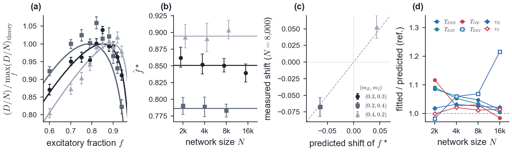

# Testing the joint-dimension optimum along the composition path

This cohort tested the four predictions of `../joint_dimension_optimum.tex` on 2,920 simulated networks of 2,000 to 16,000 neurons, and the two headline predictions held by the rules frozen in `EXPERIMENT.md` before any cohort network ran. The optimum moves with the target rates as predicted: at N = 8,000 the shift from the reference rates (0.3, 0.3) to (0.2, 0.4) is −0.067 [−0.082, −0.053] against a predicted −0.0644, and to (0.4, 0.2) it is +0.053 [+0.036, +0.070] against +0.0437. The reference optimum is 0.851 [0.841, 0.861] at N = 8,000 and 0.839 [0.826, 0.853] at N = 16,000, against the predicted 0.851, and every bootstrap draw of every cohort has a single interior maximum below 0.887. The structural claim behind these numbers, an f-independent tensor T and rate variances v, fails the frozen 10% rule at the largest size. At (0.2, 0.4) the fitted T_EEE is still 12% above prediction at N = 8,000, though falling with N (27% at 2,000). At the reference and at (0.4, 0.2) only the small, poorly determined coefficient T_EEI misses, and that coefficient is what pulls the N = 16,000 optimum 0.012 below 0.851. So the location and rate dependence agree with the theory to within about 0.01 in f, but the agreement at (0.2, 0.4) is partly a cancellation between finite-size errors in T and in v, and whether the reference optimum converges to 0.851 or drifts slightly below it isn't settled by four networks per cell at N = 16,000.

| Rate pair (m_E, m_I) | Predicted f* | N = 2,000 | N = 4,000 | N = 8,000 | N = 16,000 |
| --- | --- | --- | --- | --- | --- |
| ref (0.3, 0.3) | 0.8510 | 0.862 [0.848, 0.878] | 0.852 [0.838, 0.868] | 0.851 [0.841, 0.861] | 0.839 [0.826, 0.853] |
| lo (0.2, 0.4) | 0.7866 | 0.791 [0.778, 0.803] | 0.789 [0.774, 0.804] | 0.784 [0.774, 0.793] | |
| hi (0.4, 0.2) | 0.8948 | 0.893 [0.877, 0.912] | 0.891 [0.871, 0.914] | 0.903 [0.890, 0.918] | |

Intervals throughout are 95% percentile intervals from a bootstrap over networks within cells (4,000 draws), and the network is the unit of uncertainty.



## Design

The design, predictions and decision rules are in `EXPERIMENT.md`, written and frozen on 27 November 2026 before any cohort network was simulated. The networks follow the paper campaign's composition path: reference couplings G⁰ = [[16, 9], [25, 12]] and J⁰ = [[1, −6], [2, −10]] at f⁰ = (0.8, 0.2), presynaptic columns rescaled so that J⁰ diag(f) and G diag(f) stay fixed, Bernoulli edges, the archived engine `runtime/engine_v4.py`, midpoint step 0.05, 500 leak times of burn-in and 8,000 recorded. The unequal rate pairs enter only through `mean_rate = [m_E, m_I]` in the existing balance drive; no simulator code was changed.

| Size N | Rate pairs | Networks per cell | Networks |
| --- | --- | --- | --- |
| 2,000 | ref, lo, hi | 64 | 1,920 |
| 4,000 | ref, lo, hi | 16 | 480 |
| 8,000 | ref, lo, hi | 16 | 480 |
| 16,000 | ref | 4 | 40 |

Every cell has ten excitatory fractions, f = 0.60, 0.70, 0.75, 0.79, 0.82, 0.85, 0.88, 0.90, 0.92 and 0.94, and every network has its own seed (50001–52920 in manifest order). The predicted curve is within 1% of its maximum over a span of about 0.09 in f, so an argmax over cell means can't locate the optimum. The test instead fits the note's structure: each block energy is linear in two known functions of f, E_EE = f T_EEE + (f²/g) T_EEI, E_EI = g T_EIE + f T_EII and E_II = (g²/f) T_IIE + g T_III with g = 1 − f, fitted to the ten cell means by weighted least squares, and v_a is the mean rate variance over all networks of a cohort. The optimum f̂* is then the root of the note's quintic computed from the fitted (T, v) by `check.interior`. This pools a whole cohort into one estimate, but the estimate is only as good as the structure it assumes, which is why the structure is tested directly (P-i) and a model-free tilt is kept as a check.

## Predictions and outcomes

**P-iv, rate dependence: held.** The frozen rule asks that each shift's interval exclude zero with the predicted sign and contain the predicted value at N = 8,000. It does, and it also does at the two smaller sizes.

| N | lo − ref (predicted −0.0644) | hi − ref (predicted +0.0437) |
| --- | --- | --- |
| 2,000 | −0.072 [−0.092, −0.054] | +0.031 [+0.009, +0.055] |
| 4,000 | −0.063 [−0.085, −0.043] | +0.038 [+0.013, +0.066] |
| 8,000 | −0.067 [−0.082, −0.053] | +0.053 [+0.036, +0.070] |

The model-free tilt τ = log d̄(0.94) − log d̄(0.70), which uses no fit, agrees in sign at every size. Its differences from the reference at N = 8,000 are −0.153 [−0.215, −0.091] for lo (predicted −0.1675) and +0.157 [+0.099, +0.214] for hi (predicted +0.106); the hi interval at N = 4,000, [−0.002, +0.185], just touches zero.

**P-iii, location and uniqueness: held by the frozen rule, with a caveat about the largest size.** The rule asks that the interval at the largest size contain 0.851 and exclude 0.887, and that the N = 8,000 and N = 16,000 estimates agree within their joint uncertainty. The N = 16,000 interval [0.826, 0.853] contains 0.851 near its top edge and excludes 0.887, and the difference from N = 8,000 is −0.011 [−0.028, +0.005]. A single interior maximum appeared in 100% of bootstrap draws in all ten cohorts. The caveat is that the reference estimate falls with size, from 0.862 at N = 2,000 to 0.839 at N = 16,000, and the end-to-end difference, −0.023 [−0.043, −0.003], excludes zero (a post hoc comparison). The N = 16,000 cells hold four networks each, and the design's synthetic checks found that percentile intervals from small heavy-tailed cells cover at 90–94%, so its interval is probably somewhat too narrow. The drop at N = 16,000 comes from the denominator: with the measured T and predicted v the optimum is 0.838, with predicted T and measured v it's 0.853, and the coefficient responsible is T_EEI (below). So the data place the large-N reference optimum between about 0.83 and 0.86 and clearly below 0.887, but they don't establish that the limit is 0.851 rather than a value 0.01–0.02 lower.

**P-i, structure: failed by the frozen rule.** The rule asks that every ratio that moves f* appreciably (T_EEE, T_EIE, T_EEI, v_E, v_I, and T_IIE for lo) be within 10% of prediction at the largest size and move toward it with N. Fitted over predicted, at the largest size of each pair:

| Quantity | ref, N = 16,000 | lo, N = 8,000 | hi, N = 8,000 |
| --- | --- | --- | --- |
| T_EEE | 1.013 [0.993, 1.034] | 1.119 [1.098, 1.138] | 1.024 [1.004, 1.042] |
| T_EIE | 1.004 [0.976, 1.032] | 1.081 [1.057, 1.105] | 1.027 [1.004, 1.050] |
| T_IIE | 0.984 [0.933, 1.032] | 1.054 [1.016, 1.092] | 1.035 [0.989, 1.083] |
| T_EEI | 1.215 [1.021, 1.412] | 1.218 [1.114, 1.327] | 0.863 [0.609, 1.115] |
| T_EII | 1.084 [0.973, 1.196] | 1.090 [1.029, 1.155] | 0.925 [0.825, 1.022] |
| T_III | 1.051 [0.999, 1.105] | 1.057 [1.018, 1.097] | 0.995 [0.955, 1.032] |
| v_E | 1.021 [1.014, 1.028] | 1.080 [1.074, 1.086] | 1.007 [1.000, 1.014] |
| v_I | 1.014 [1.005, 1.023] | 1.045 [1.038, 1.051] | 1.003 [0.994, 1.011] |

At lo the failure is unambiguous: T_EEE and T_EEI are 12% and 22% high at N = 8,000. They are coming down with size (T_EEE 1.27, 1.19, 1.12 and v_E 1.14, 1.10, 1.08 at N = 2,000, 4,000, 8,000), so this reads as a finite-size excess that hasn't yet fallen below the threshold. At the reference the large coefficients are within 1.5% at N = 16,000 and both v within 2.1%, and at hi everything except T_EEI is within 4%. The misses there are T_EEI alone, which at the reference rises from 0.98 at N = 2,000 to 1.07 at 8,000 and 1.21 at 16,000, and at hi falls to 0.86 with an interval from 0.61 to 1.11. T_EEI is about 1.6% of T_EEE, so its ratio is noisy, but it multiplies f²/g, which grows quickly near f = 1, and it moves f* more than any other coefficient. It's the least well measured ingredient that matters, and the four networks per cell at N = 16,000 can't say whether its rise at the reference is real.

The fit quality and the f-independence of v are mostly fine. Block χ² at N = 8,000 is 5.5–13.4 on 8 degrees of freedom and at N = 16,000 3.4–7.2, against 16–17 at N = 2,000 for the reference (where cells hold 64 networks, so small curvature shows up). The weighted slope of v_E against f is 0.0128 ± 0.0046 at reference N = 16,000 (χ² 22.4 on 9 about a constant), a change of about 3% of v_E across the fraction range, and 0.0068 ± 0.0027 at lo N = 8,000; the other slopes are within two standard errors of zero.

At lo the finite-size errors in T and in v push the optimum in opposite directions: measured T with predicted v gives 0.771, predicted T with measured v gives 0.799, and the full fit gives 0.784, near the predicted 0.787. The good location at lo is therefore partly a cancellation between two errors that are each still 8–12% (a post hoc observation from secondary comparison 2).

**P-ii, the four-coefficient form of D/N: supported, not tested separately.** The form follows algebraically from P-i, so it wasn't given its own decision rule. The fitted two-term block forms describe the cell means within their noise at N ≥ 4,000 (χ² above), and measured cell-mean D/N lies within 0.90–1.07 of the parameter-only prediction at N = 2,000 and within about 3–7% at N = 8,000.

## Secondary checks

* **Estimator windows.** Recomputing from the 4,000-leak-time window or with one empty block between windows changes f̂* by at most about 0.004 in any cohort.
* **Rates against targets.** The unequal-rate drive holds across the cohort: the largest cell-mean deviation of the E rate from its target is 0.014 (lo, N = 2,000) and 0.0105 (hi, N = 2,000), and 0.003 or less at N = 8,000 and 16,000.
* **Fixed-point networks.** All 2,920 networks completed with no failures. Ten reached a fixed point (final drift below 1e−10), all hi at N = 2,000: one at f = 0.88, two at 0.90, seven at 0.94. They're counted and excluded from the averages, not replaced, so those cells hold 63, 62 and 57 networks.
* **Campaign replication.** Fitting the 624 existing reference networks at N = 2,000 (13 fractions × 48) the same way gives f̂* = 0.858 [0.844, 0.873] and block χ² of 21–23 on 11 degrees of freedom, consistent with this cohort's 0.862 at the same size. That fit was seen before the design was frozen, so it's a replication, not evidence for the primary comparisons.
* **Network-to-network spread.** The relative spread of block energies across networks falls faster than N^−1/2 (`diag_spread_vs_size`).

## Checks on the code and the run

1. **Generator.** `mean_rate = [0.3, 0.3]` gives arrays bit-identical to scalar 0.3, the unequal-rate drive equals the hand value to 1e−12 after a JSON round trip, and connectivity is unchanged (`validate.py`, `validation.json`). Passed.
2. **Check networks.** Ten N = 2,000 networks outside the cohort (seeds 59001–59010): 8 of 10 had population rates within 0.02 of target. The two misses, both lo at f = 0.94, were recorded in `EXPERIMENT.md` before freezing; at N = 8,000 the same cells are within 0.003.
3. **Estimator on synthetic cohorts.** Exact recovery of T, v and f* with zero noise (1e−12 and 1e−9), bias under 0.001 and 90–96% interval coverage at the planned designs (`estimator_validation.json`). Passed.
4. **Replay.** An archived campaign network (`pc_composition_f0.86_N2000_seed43020`) rerun on a pod reproduced its record and arrays bit for bit (`replay.json`, `checks/replay/`). Passed.
5. **Collection.** SHA-256 of every record, array and audit file compared between each pod and the local copy before that pod was stopped: 5,984 files, no mismatches. Passed.

## Limitations

* N = 16,000 covers only the reference pair with four networks per cell, so its intervals are probably anti-conservative and it can't tell a real downward drift of f* from noise in T_EEI.
* The largest size for the unequal pairs is 8,000, and at lo the structure is still 8–12% off there; whether lo meets the structure at larger N is an extrapolation of the trend, not a measurement.
* f̂* is a model-based estimate that assumes the note's structure. Where that structure is off (lo, and T_EEI generally), the location agreement can partly come from errors that cancel, as the decomposition shows at lo. The model-free tilt agrees in sign and roughly in size, which guards against the fit inventing the rate dependence, but it doesn't locate the optimum.
* The 10% threshold in P-i is a judgment fixed in advance, not a derived bound.

## Amendments

One operational amendment, dated 27 November 2026 at about 16:31 UTC, is recorded in `EXPERIMENT.md`; it changed nothing about the cohort, seeds, code or analysis. The runner's resource model held pods to three to seven concurrent networks, so runners were restarted with higher limits and `--only` lists, refilled periodically, and long queues were split onto idle pods (`checks/pod_scripts/restart.sh`, `refill.sh`, `split.py`). A second split at about 17:10 UTC for stripes 17, 19, 21 and 22 didn't exclude names already handed over, so some networks started on two pods; `rebalance.py` killed the nine younger copies and dealt the rest to disjoint runners. Thirteen networks (all N = 2,000) still finished on two pods. Their per-neuron arrays are byte-identical, and one copy is kept; they're listed in `cloud_execution.json`.

## Files

Main figures (each with a PDF and a caption `.txt` in `figures/`):

* `figures/paper_composition_optimum.png`: the compact paper figure: (a) D/N against f at N = 8,000 for the three rate pairs with the parameter-only curves, (b) f̂* against N, (c) measured against predicted shifts, (d) fitted reference coefficients over predicted against N.
* `figures/main_optimum_vs_size.png`: f̂* for each pair and size against the predictions.
* `figures/main_structure_vs_size.png`: fitted T and v over predicted against size.
* `figures/main_dimension_curves.png`: measured cell means and fitted curves at N = 8,000.

Diagnostics in `figures/diag_*.png` cover all cohorts' dimension curves, block energy ratios and fits, residuals, v against f, rates against targets, bootstrap distributions, the tilt, window sensitivity, the decomposition, per-cell D/N ratios, spread against size, the campaign replication and the ratio bias. The tables behind them are `optimum.csv`, `structure.csv`, `cells.csv`, `bootstrap_fstar.csv`, `networks.csv` and `results.json` (copied into `figures/`); `coverage.json` counts planned, complete and fluctuating networks per cell.

Raw output is 247 MB and stays in this directory: `records/` (23 MB, one gzip JSON per network) and `arrays/` (224 MB, per-neuron statistics).

## Reproduction

From this directory, with the repository's environment:

```
python3 predictions.py              # parameter-only predictions -> predictions.json
python3 prepare.py                  # manifest -> jobs.json
python3 validate.py                 # generator check
python3 validate_estimator.py       # synthetic estimator check
python3 run.py --part i/24          # one stripe per machine, i = 1..24; writes records/ and arrays/
python3 summarize.py                # -> networks.csv, coverage.json
python3 analyze.py --draws 4000     # -> results.json and the CSV tables
python3 plots.py                    # -> figures/
```

## Compute

All work ran on Runpod secure cloud in EUR-IS-1 under the CBAI team account (verified with `get-account` before any pod was created), on 25 CPU pods named `aniket-eibalance-val-01` to `-25`: 22 `cpu5c` 16-vCPU pods at $0.56/h and two `cpu3c` 32-vCPU pods at $0.96/h for the cohort, and one `cpu3c` 16-vCPU pod at $0.48/h for the replay. The total rate was $14.72/h; `EXPERIMENT.md` states $14.24/h, which is the cohort pods without the replay pod. Pods ran from 16:01 to 18:13 UTC on 27 November 2026, 41.1 pod-hours in all, for an estimated $24.61 (uptime at stop times the quoted rate; stopped pods keep billing for their disks). Each pod had a 6-hour self-stop timer armed and verified first, and every pod was stopped, not terminated, and read back as EXITED. Pod ids, uptimes and costs are in `cloud_execution.json`.
